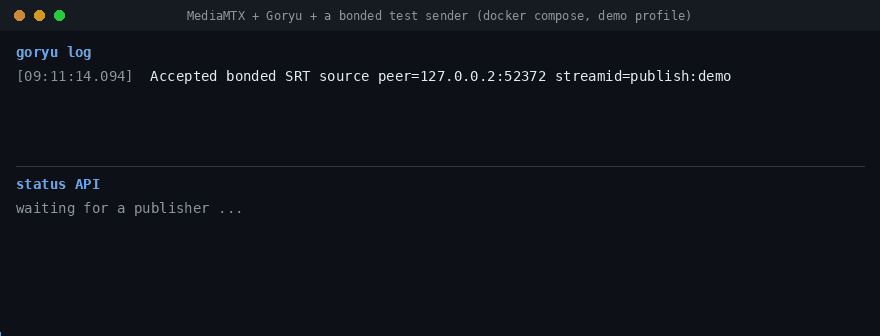

# Goryu

_Goryu (合流, "confluence"): many network paths, one stream._

[](https://github.com/live-miracles/goryu/actions/workflows/ci.yml)
[](https://github.com/live-miracles/goryu/releases/latest)
[](https://hub.docker.com/r/nandisha0/goryu)
[](https://github.com/Haivision/srt)
[](LICENSE)

**Bonded SRT for servers that don't speak it.** SRT bonding sends one stream over several network links (two uplinks, two SIMs) so a failing link doesn't drop the stream. SRS, MediaMTX and Restreamer's engine (datarhei Core) reject a bonded SRT group. Goryu sits in front of them: it accepts the group, merges the legs into one deduplicated stream, and forwards ordinary SRT to your server under the same `streamid`. A plain single-link SRT caller works on the same port.

<p align="center"></p>

One C binary on [libsrt](https://github.com/Haivision/srt) 1.5.6, a short JSON config, and a loopback JSON status API with per-leg telemetry. It is also the bonded-SRT ingress of [Bunryu](https://github.com/live-miracles/bunryu). Walkthrough: [SRS, MediaMTX and Restreamer reject bonded SRT. Here is a relay that fixes it](https://live-miracles.github.io/blog/srs-mediamtx-restreamer-reject-bonded-srt/).

## Works in front of

A bonded group was sent to each server directly and through Goryu, then the stream was read back from the server ([details](docs/2-usage/3-downstream-servers.md)):

| Server | Bonded group sent directly | Through Goryu |
|---|---|---|
| SRS 7.0.189 | rejected | accepted, stream read back |
| MediaMTX v1.21.2 | rejected | accepted, stream read back |
| datarhei Core 16.16.0 (Restreamer's engine) | rejected | accepted, stream read back |

Those runs used legs simulated on loopback. On real links:

- A real AJA BRIDGE LIVE encoder sending two legs across the internet (about 41 to 44 ms RTT, 22.6 Mbps per leg, packet loss on both legs) was accepted and forwarded to SRS by a deployed relay. That is the setup we run our live events on every day.
- Unplugging one of its two cables for 45 seconds left the stream flowing at the same rate, and the leg rejoined by itself.
- Not tested: a link that degrades under heavy loss rather than disconnecting.

You still need a sender that implements SRT bonding: see [Sending bonded SRT](docs/2-usage/2-sending-bonded-srt.md) for what can send one and a test caller you can run today. For SRTLA or a server with built-in bonding, see [Alternatives](docs/1-getting-started/3-alternatives.md).

## Features

- [Bonded and plain SRT](docs/1-getting-started/1-introduction.md) on one listener; the status API tells them apart.
- [Streamid passthrough](docs/2-usage/1-configuration.md#streamid-routing): one listener serves many streams, each forwarded under its own streamid.
- [Passphrase](docs/2-usage/1-configuration.md#passphrase) for the input and, unless you set `output_passphrase`, the downstream connection.
- [Per-leg telemetry](docs/4-reference/1-status-api.md): RTT, loss, latency, bandwidth and buffer occupancy for every leg, plus the output connection.
- [Built to stay up](docs/3-operations/1-reliability.md): bounded retry with backoff to the downstream, takeover of a stale publisher, and a hard cap on log volume.

## Quick start

No second uplink handy? `docker compose -f docker/compose.yaml --profile demo up --build` runs MediaMTX, Goryu and a bonded test sender, so you can watch the legs merge with no hardware ([details](docs/1-getting-started/2-install.md#docker)).

<p align="center"></p>

<sub>The demo's own output, replayed at twice the speed. The test sender closes its second leg after 25 s (`SENDER_ARGS="--drop-leg 1 --drop-after 25"`); the log line and the status come straight from Goryu v3.4.0.</sub>

```bash
curl -fsSL -o goryu.tar.gz https://github.com/live-miracles/goryu/releases/latest/download/goryu-linux-x86_64.tar.gz
mkdir goryu && tar -xzf goryu.tar.gz -C goryu && cd goryu
```

Create `goryu.json`, pointing `output_port` at your server's SRT port (for example `8890` for MediaMTX, `10080` for SRS):

```json
{
  "input_host": "0.0.0.0",
  "input_port": 10081,
  "output_host": "127.0.0.1",
  "output_port": 10080,
  "status_port": 8081,
  "passphrase": ""
}
```

Run it, then check it is up (or use [Docker](docs/1-getting-started/2-install.md#docker)):

```bash
LD_LIBRARY_PATH=lib ./bin/goryu goryu.json
curl http://127.0.0.1:8081/status
```

Point a bonded sender at `srt://<host>:10081` with the `streamid` your server expects for a publish ([per server](docs/2-usage/3-downstream-servers.md#configure-the-streamid)). Once a stream is flowing, the status API shows each leg (a trimmed response from the loopback test above):

```json
{
  "streamId": "camera1/main",
  "inputActive": true,
  "outputConnected": true,
  "input": {
    "bonded": true,
    "legs": [
      { "ip": "127.0.0.1", "state": "running", "rttMs": 0.166, "recvLossTotal": 0, "rcvBufMs": 227 },
      { "ip": "127.0.0.2", "state": "running", "rttMs": 0.154, "recvLossTotal": 0, "rcvBufMs": 220 }
    ]
  }
}
```

If a leg fails, it leaves `legs[]` and `forwardedBytes` keeps growing; the downstream never notices. See [Install](docs/1-getting-started/2-install.md) for systemd and the firewall port, and [Configuration](docs/2-usage/1-configuration.md) for every field.

## Documentation

- **Getting started:** [Introduction](docs/1-getting-started/1-introduction.md) · [Install](docs/1-getting-started/2-install.md) · [Alternatives](docs/1-getting-started/3-alternatives.md)
- **Usage:** [Configuration](docs/2-usage/1-configuration.md) · [Sending bonded SRT](docs/2-usage/2-sending-bonded-srt.md) · [Downstream servers](docs/2-usage/3-downstream-servers.md)
- **Operations:** [Reliability](docs/3-operations/1-reliability.md)
- **Reference:** [Status API](docs/4-reference/1-status-api.md) · [Architecture](docs/4-reference/2-architecture.md) · [Development](docs/4-reference/3-development.md)

## Help

Ask questions and share ideas in [Discussions](https://github.com/live-miracles/goryu/discussions). Report bugs as [issues](https://github.com/live-miracles/goryu/issues/new/choose).

## License

[MIT](LICENSE). libsrt and OpenSSL are separate projects under their own licenses.
